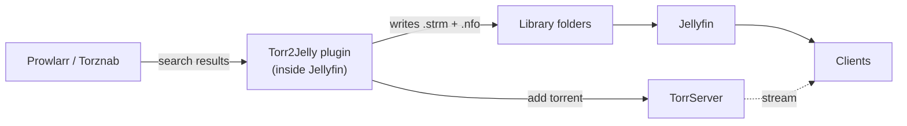

# Jellyfin Plugin Torr2Jelly

<p align="center">
  
</p>

<p align="center">
  <strong>Search torrents from inside Jellyfin and stream them through TorrServer, with nothing downloaded up front.</strong>
</p>

---

Torr2Jelly is a Jellyfin plugin that turns torrents into a streamable Jellyfin library via [TorrServer](https://github.com/YouROK/TorrServer). When you add a release, the plugin hands it to TorrServer and writes small `.strm` files that point at TorrServer's stream endpoint (`/stream?link=<infohash>&index=<file>&play`), plus `.nfo` sidecars with TMDb/IMDb ids when they are known. The files go into category folders that you add to Jellyfin as libraries. Jellyfin scans them like any other media, and TorrServer fetches the torrent data on demand while you watch.

## Features

- **Indexer search** through [Prowlarr](https://prowlarr.com) (JSON API) and/or any Torznab endpoint (for example [Jackett](https://github.com/Jackett/Jackett)). Results from several indexers are merged and de-duplicated by info-hash.
- **Search where you already are.** Results appear as a "Torrents" section at the bottom of Jellyfin's own search page and on the plugin's admin page. One click adds a release to TorrServer and generates the files.
- **Add by link.** Paste a magnet link or a `.torrent` URL on the admin page.
- **Extra versions of a movie** (admins). From a movie's page, add another release as an additional version, using Jellyfin's native multi-version switching. Versions can be replaced or deleted.
- **New seasons for a series** (admins). From a series' page, add a release (for example a new season pack) and its episodes are written into that series' folder, season by season.
- **Categories.** Each category has a name, a type (movie or show) and a folder. File and folder names follow configurable templates. Season packs, multi-file torrents and releases with Ukrainian or Russian titles are handled.
- **Tracker and tag rules.** Enable or disable trackers one by one, choose which tags are allowed per tracker (freeleech, halfleech, and so on), filter searches to tagged releases, and optionally limit non-admin users to tagged releases.
- **Library sync.** The scheduled task "Torr2Jelly Library Sync" keeps the files in step with TorrServer. "Scan library" on the admin page also removes `.strm` files of torrents that no longer exist in TorrServer.
- **Optional TorrServer tuning.** Push cache settings (cache size, disk cache path, preload, read-ahead, disconnect timeout) and a VPN-forwarded peer port from the plugin. Off by default on new installs.
- **English and Ukrainian** interface.
- **Settings backup.** The plugin keeps JSON backups of its settings and restores them if its configuration file goes missing.

## How it works



1. You search; Torr2Jelly queries your indexers.
2. You add a release; the plugin adds the torrent to TorrServer and writes `.strm` and `.nfo` files into the category folder.
3. The plugin asks Jellyfin to scan the changed folder, and the item shows up like any other library item.
4. On playback the URL inside the `.strm` points at TorrServer, which streams the torrent. Depending on the client and on whether Jellyfin transcodes, that URL is opened by the client or by the Jellyfin server, so both must be able to reach it.

**Web client integration.** The plugin adds its script to Jellyfin's web client page while that page is served. This works with the read-only web directory of the official Docker image, survives Jellyfin updates and works under a Jellyfin base URL. If the web directory happens to be writable, the plugin also writes the same script tag into `index.html` at startup.

## Compatibility

| Jellyfin | Status |
| --- | --- |
| 10.8 and older | not supported (plugin targets .NET 8 / ABI 10.9) |
| 10.9.x | supported (built against 10.9.11) |
| 10.10.x | supported |
| 10.11.x | supported |
| 12.0 – 12.2 | supported, tested on 12.2.0 |

**Clients.** Playback of the generated items works in every Jellyfin client. The plugin's own UI (the search section, the versions dialog and the admin page) is part of the server's web client, so it is available wherever that web client is used: browsers, Jellyfin Media Player, and the mobile apps that load the server's web UI. Native TV apps (for example Android TV, Swiftfin, Roku, Kodi) can browse and play the added items but do not show the plugin UI.

## Requirements

- **TorrServer**, running and reachable from the Jellyfin server. Torr2Jelly does not install or start it.
- **Two TorrServer addresses**, because the server that talks to TorrServer is not always the machine that plays the video:

  | Setting | Used for | Default |
  | --- | --- | --- |
  | TorrServer URL (API & Streaming) | API calls from the Jellyfin server: adding, listing and removing torrents, health checks | `http://torrserver:8090` |
  | TorrServer Stream URL (for .strm files) | Base URL written into every `.strm` file and opened at playback time. If left empty, the TorrServer URL is used. | `http://torrserver:8090` |

  The defaults only work where the host name `torrserver` resolves (for example one Docker network). If players sit outside that network, set the Stream URL to an address they can reach, such as `http://192.168.1.10:8090`. Files already written get the new URL on the next sync.
- **An indexer:** Prowlarr, a Torznab endpoint, or both.
- **Category folders** that are inside (or are) Jellyfin library folders, visible to the Jellyfin process or container, and writable by it.

## Installation

1. In Jellyfin, open **Dashboard → Plugins → Repositories** and click **+**.
   - Repository name: `Torr2Jelly Repository`
   - Repository URL:
     ```text
     https://raw.githubusercontent.com/D1st3f-PRJCTS/jellyfin-plugin-torr2jelly/main/manifest.json
     ```
2. Open the **Catalog** tab, find **Torr2Jelly** and install it.
3. Restart Jellyfin.
4. Open **Dashboard → Torr2Jelly**.

To install a build from source instead, see [Building from source](#building-from-source).

## Setup

1. **TorrServer.** On **Settings → TorrServer**, enter the TorrServer URL and the Stream URL (see [Requirements](#requirements)), then press **Test TorrServer**.
2. **Indexers.** On **Settings → Indexers**, tick **Use Prowlarr** and enter its URL and API key, and/or tick **Use Torznab** and enter the full Torznab feed URL of the indexer (for Jackett, the feed URL it shows for an indexer) and its API key. **Test Prowlarr** checks the Prowlarr connection.
3. **Categories.** On **Settings → Library & categories**, point each category at a folder. A new install starts with Movies and Shows (the defaults), plus Cartoons and Anime, using the relative folders `movies`, `shows`, `cartoons` and `anime` under the media root (`/media` by default). Absolute paths are used as they are, so entering the real paths is the least surprising option. **Auto-fill from Jellyfin** proposes one category per existing movie or TV library, using the library's first folder.
4. **Jellyfin libraries.** Under **Dashboard → Libraries**, create a Movies library and a Shows library that include those category folders (or reuse existing libraries whose folders you used above).
5. Press **Save Settings**.
6. **Search and add.** Use Jellyfin's search page or the **Search** tab of the admin page.

A fresh install shows the admin page in Ukrainian. Change this under **Settings → Language**. The "Torrents" section on Jellyfin's search page follows the language chosen on the admin page in the same browser and otherwise the Jellyfin or browser language.

## Using it

### On Jellyfin's search page

Search for a title as usual. A "Torrents" section at the bottom lists matching releases from your indexers with seeders, size and tracker tags. Choose the target category or library, optionally limit the list to releases with tags, and press **Add**. The first eight results are shown, with **Show all** for the rest. Once TorrServer has loaded the torrent's metadata the real files replace the first placeholder (see [Troubleshooting](#troubleshooting)).

### On a movie's page (admins)

Administrators see an icon button (tooltip "Torrent versions") next to the usual buttons on movie pages. It opens a dialog with two tabs:

- **Versions** lists the movie's torrent versions and lets you delete one.
- **Find releases** searches for other releases (by IMDb id when the movie has one, otherwise by title and year). **Add as version** adds a release next to the existing ones; **Replace current** swaps it in. Replacing and deleting ask for confirmation.

Jellyfin then offers the versions in its normal version picker. A torrent is removed from TorrServer only when no remaining `.strm` file uses it.

### On a series page (admins)

Administrators see an **Add torrents to this series** button on series pages. It opens a search prefilled with the series title (IMDb id first, when the series has one); you can also type your own query. **Add to this series** adds the release to TorrServer and writes its episodes straight into that series' existing folder, one `Season NN` folder per season, so a new season pack lands next to the seasons you already have. The series' own `tvshow.nfo` and artwork are left untouched. If TorrServer is still loading the torrent's file list, the episodes appear on the next sync.

### Admin page (Dashboard → Torr2Jelly)

| Tab | What it does |
| --- | --- |
| **Search** | Search your indexers, filter by category and tags, sort by priority, seeders or size, and add a result to a chosen category. |
| **Add magnet** | Add a magnet link or `.torrent` URL, with an optional custom title, a category and a "generate .strm immediately" option. |
| **Torrents** | Lists the torrents in TorrServer. Change a torrent's category (its files are moved), delete it (together with its `.strm` files), refresh the list, or run **Scan Library**. |
| **Settings** | TorrServer, Indexers, Library & categories, Trackers & tags, Naming and Language. |

### Library sync

- **Scheduled task.** "Torr2Jelly Library Sync" appears under **Dashboard → Scheduled Tasks** in the Library group. Its default trigger is every 15 minutes; change the schedule there. A run creates and updates files for the torrents in TorrServer, including torrents that were added to TorrServer directly rather than through the plugin. It never deletes files.
- **Scan Library** (Torrents tab) does the same sync, additionally removes the `.strm` files of torrents that no longer exist in TorrServer, and asks Jellyfin to scan. If TorrServer cannot be reached, or reports no torrents at all, nothing is removed.
- `AutoSyncTorrents` (on by default) and `AutoSyncIntervalMinutes` (default 15, minimum 5) exist in the plugin configuration but have no field on the settings page. The interval only sets the task's default trigger.

### Folder layout and naming

```text
<movie category folder>/
  Title (Year)/
    Title (Year).strm
    movie.nfo
<show category folder>/
  Show (Year)/
    tvshow.nfo
    Season 01/
      Show - S01E01.strm
```

The names come from the templates under **Settings → Naming** (available tokens: `{Title}`, `{Year}`, `{Season:00}`, `{EpisodeTag}`). Defaults:

| Template | Default |
| --- | --- |
| Movie folder | `{Title} ({Year})` |
| Movie file | `{Title} ({Year}).strm` |
| Series folder | `{Title} ({Year})` |
| Season folder | `Season {Season:00}` |
| Episode file | `{Title} - {EpisodeTag}.strm` |

The two "Rename ... using templates" switches turn renaming off for movies or series, which keeps the original torrent names.

### Trackers and tags

On **Settings → Trackers & tags**, every tracker known to Prowlarr gets a card where it can be disabled and where you choose the allowed tags: Gold (freeleech), Silver (halfleech), Bronze, Author (internal), Exclusive, 2x Upload and Untagged (regular). A release is shown if its tracker is enabled and the release carries at least one allowed tag, or carries no tag and Untagged is allowed. Tags are taken from what the indexer reports (tags, flags, upload and download factors) and from a few markers in the release title.

Two switches build on this:

- **Search only releases with tags by default** turns the "only with tags" filter on for searches by default.
- **Only tagged releases for regular non-admin users** forces that filter for everyone who is not an administrator.

### TorrServer cache settings (optional)

With **Push cache settings to TorrServer** ticked, the plugin applies the cache size, disk cache on/off and path, preload, read-ahead and disconnect timeout from the settings page to TorrServer when you save and about once a minute afterwards. Leave it off if you manage TorrServer yourself. It also switches TorrServer's `RemoveCacheOnDrop` option off.

The plugin can additionally push a VPN-forwarded peer port. Set `ForwardedPortFilePath` to the file that holds the port; several candidate files can be given, separated by `;`, and the first one that exists and holds a valid port is used. This setting has no field on the settings page: set it through the plugin's settings API (`POST /Plugins/Torr2Jelly/Settings`, administrators only) or in the plugin's configuration file. It only takes effect while cache settings are pushed.

## Permissions and safety

All plugin API endpoints require a Jellyfin login. The one exception is the static client script (`/Plugins/Torr2Jelly/search.js`), which the web client has to load before anyone signs in.

| Action | Signed-in user | Administrator |
| --- | --- | --- |
| Search the indexers | yes (limited to tagged releases if configured) | yes |
| Add a release (magnet link, `.torrent` URL or info-hash) | yes | yes |
| See server folder paths | no | yes |
| Settings, torrent list, category changes, deleting torrents, Scan Library, TorrServer status | no | yes |
| Torrent versions on a movie's page, adding torrents to a series | no | yes |

Anyone with a Jellyfin account can add torrents to your TorrServer, so hand out accounts accordingly or restrict non-admin users to tagged releases.

Other safeguards:

- **Indexer API keys** are stripped from the search results and links sent to the browser and re-added on the server when a release is added. Only the administrators' settings page loads the saved keys, because it edits them.
- **Files are deleted conservatively.** The plugin deletes only `.strm` files that it can prove belong to a torrent (the info-hash is parsed from the file's URL) and only inside the category folders. Actions aimed at one specific torrent or movie version may also reach Jellyfin library folders.
- **No purge without a torrent list.** If TorrServer is unreachable, or returns no torrents, nothing is removed. Files written in the last two minutes are not treated as orphans.
- **Unsafe category roots are refused.** A category folder is ignored (with a warning in the Jellyfin log) if it is a filesystem root, contains Jellyfin's own data, configuration, cache, log or plugin folders, or is a relative folder with `..` segments.

## Troubleshooting

**The "Torrents" section does not appear on the search page.**
Hard-refresh the browser. The web client has to reload its page once after the plugin is installed or updated. Also check that an indexer is enabled and passes its test, and look for `Torr2Jelly` lines in the Jellyfin log.

**The settings page shows HTTP 401.**
Update to 1.0.19.1 or newer. Newer Jellyfin servers disable legacy authorization headers, which older versions of the page still used.

**An item appears but does not play.**
The Stream URL must be reachable from the device that plays (or from the Jellyfin server, if it transcodes), and TorrServer must be running. A quick test is to open the URL stored in the `.strm` file from that device.

**A newly added torrent shows a single placeholder file.**
TorrServer is still loading the torrent's metadata. The real files appear on the next sync: wait for the scheduled task or press **Scan Library**.

**No files are created when Jellyfin runs in Docker.**
The category folder is probably not mounted into the container, or the Jellyfin container cannot write to it. Also check the log for a category being ignored as an unsafe root.

**Files disappeared after "Scan Library".**
Scan Library removes the `.strm` files of torrents that are no longer in TorrServer. If you removed torrents from TorrServer directly, their files go too.

## Building from source

You need the .NET 8 SDK.

```bash
git clone https://github.com/D1st3f-PRJCTS/jellyfin-plugin-torr2jelly.git
cd jellyfin-plugin-torr2jelly
dotnet build -c Release
```

The plugin is `bin/Release/net8.0/Jellyfin.Plugin.Torr2Jelly.dll`. To install it by hand, copy it into `<jellyfin config>/plugins/Torr2Jelly_<version>/` (use the version from the `.csproj`) and restart Jellyfin.

**Releases.** Pushing a `v*` tag runs the GitHub Actions workflow, which builds the plugin and attaches `Torr2Jelly_<version>.zip` to a GitHub release. The same workflow also builds on pushes to `main` and on pull requests, without publishing. `manifest.json` lists every version with its download URL and the MD5 checksum of that zip.

## License

Distributed under the **MIT License**.
